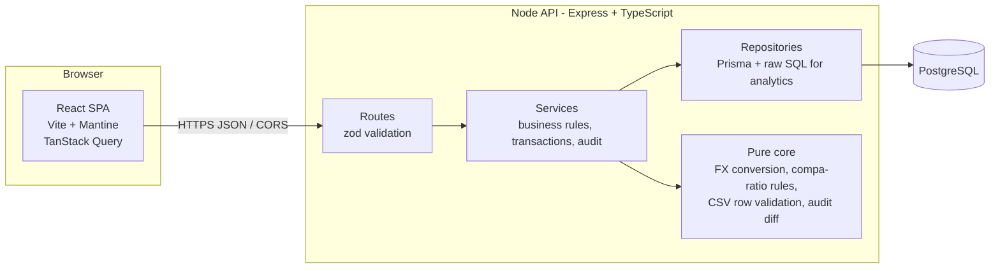

# Design

Companion to [REQUIREMENTS.md](REQUIREMENTS.md). This covers the architecture, data model, API, analytics approach, testing and performance, plus the trade-offs behind each choice.

## Architecture

- **Repo layout:** a TypeScript monorepo using npm workspaces, with `apps/api`, `apps/web` and `packages/shared`. The shared package holds zod schemas, types and constants (e.g. outlier defaults). API validation and frontend forms both use it, so each rule is written once.
- **Layers:**
  - **Routes** only parse and validate input.
  - **Services** hold business rules and wrap each change _and its audit record_ in one DB transaction.
  - **Repositories** are the only code that touches Prisma or SQL.
  - The **pure core** has no I/O and is unit-tested.
- **Deployment:** frontend, API and database are deployed separately. Planned: web on Vercel, API on Render, Postgres on Neon (confirmed at the deploy step). The API allows the web origin via CORS, and the web app reads `VITE_API_URL`.

### Key trade-offs

| Choice           | Over                       | Why                                                                                                                                      |
| ---------------- | -------------------------- | ---------------------------------------------------------------------------------------------------------------------------------------- |
| Separate deploys | One server serving the SPA | Each side deploys and scales independently, and the frontend is served from a CDN. The cost is CORS and two URLs.                        |
| Express          | Fastify / NestJS           | Familiar and minimal. Performance differences don't matter at this scale.                                                                |
| Prisma           | Drizzle / raw SQL          | Typed client and migrations. Raw SQL (`$queryRaw`) is used where aggregates need it.                                                     |
| PostgreSQL       | SQLite                     | Native `percentile_cont` and window functions keep analytics in the DB. Free hosts have ephemeral disks, which would wipe a SQLite file. |
| TypeScript       | Plain JS                   | Money arithmetic and shared API shapes benefit from types. Prisma generates them.                                                        |

## Data model

| Table               | Key fields                                                                                                                                                                                                                                                                                       |
| ------------------- | ------------------------------------------------------------------------------------------------------------------------------------------------------------------------------------------------------------------------------------------------------------------------------------------------ |
| `Employee`          | id, employeeCode (unique, e.g. `E00042`), firstName, lastName, email (unique), countryCode → `Country`, departmentId → `Department`, jobTitleId → `JobTitle`, level (1–6), hireDate, status (`ACTIVE`/`TERMINATED`), terminationDate, **currentBaseSalary, currentTargetBonus, currentCurrency** |
| `CompensationEntry` | id, employeeId, effectiveDate, baseSalary, targetBonus, currency, reason (`HIRE`/`PROMOTION`/`MERIT`/`MARKET_ADJUSTMENT`/`OTHER`), note                                                                                                                                                          |
| `Department`        | id, name (unique)                                                                                                                                                                                                                                                                                |
| `JobTitle`          | id, name (unique)                                                                                                                                                                                                                                                                                |
| `Country`           | code, name, currency                                                                                                                                                                                                                                                                             |
| `FxRate`            | currency, rateToUsd, asOfDate                                                                                                                                                                                                                                                                    |
| `AuditLog`          | id, actorId → `User`, employeeId, entityType, entityId, action (`CREATE`/`UPDATE`/`TERMINATE`), changes (JSON `[{field, from, to}]`), reason, createdAt                                                                                                                                          |
| `User`              | id, name. Seeded with one "HR Manager"                                                                                                                                                                                                                                                           |

- **Money:** integers in **whole units of local currency**. Annual salaries don't need cents, JPY has no minor unit, and this avoids floating-point drift and Prisma's `Decimal`.
- **Current compensation is stored on `Employee`.** It's recalculated from the latest entry (by effective date) in the same transaction as any entry change. Analytics then read one row per employee with no "latest entry" subquery. The cost is duplicated data, guarded by integration tests that check it matches the history.
- **Reference tables** for departments and job titles keep grouping consistent, and give CSV import and forms something to validate against.
- **Audit:** one row per action, holding a JSON list of field changes. A promotion that changes level, title and pay shows as a single event. The actor comes from `getCurrentUser()`, which returns the seeded HR Manager for now and is the single place real auth would plug in.
- **Currency conversion:** `amount_in_X = amount_local / rateToUsd(local) × rateToUsd(X)`. It's done in SQL for aggregates and in the pure core for single values, and both are tested against the same fixtures.

## API

| Method & path                              | Purpose                                                                                 |
| ------------------------------------------ | --------------------------------------------------------------------------------------- |
| `GET /employees`                           | Search, filters (country, dept, title, level, status), sort, pagination                 |
| `GET /employees/:id`                       | Profile + current comp                                                                  |
| `POST /employees` · `PATCH /employees/:id` | Create / edit (edit requires a reason)                                                  |
| `POST /employees/:id/terminate`            | Soft-terminate                                                                          |
| `GET/POST /employees/:id/compensation`     | Timeline / add a pay change                                                             |
| `PATCH /compensation/:entryId`             | Correct a mistake (reason required)                                                     |
| `GET /audit` · `GET /employees/:id/audit`  | Org-wide / per-employee audit                                                           |
| `POST /imports/employees`                  | CSV upload. `201 {imported}` or `422 {errors: [{row, field, message}]}`, all-or-nothing |
| `GET /insights/pay-stats`                  | `groupBy`, `metric=base\|total`, `currency`, filters                                    |
| `GET /insights/outliers`                   | `low`, `high`, `minPeers`, `metric`, filters                                            |
| `GET /insights/recent-changes`             | Raises within `from`–`to`                                                               |
| `GET /meta`                                | Countries, departments, titles, levels, FX rates + as-of date, outlier defaults         |

Errors use one JSON shape: `{error: {code, message, details?}}`.

## Analytics

- **Pay stats:** count, min, max, avg and sum via SQL `GROUP BY`; median via `percentile_cont(0.5)`. Everything runs in Postgres, and only aggregated rows are returned. Terminated employees are excluded by default.
- **Peer outliers:**
  - Peers share **job title + level + country**.
  - **Peer compa-ratio = pay ÷ peer-group median**, using base or total cash as selected.
  - Defaults are a band of **0.80–1.20** and a **minimum group of 5**, defined once in `packages/shared`. HR can adjust both in the UI (range slider), and the API validates `0 < low < 1 < high`.
  - Results show the person, their pay, peer median, compa-ratio and group size, sorted by distance from 1.00. Groups below the minimum are reported as "not enough peers", not flagged.
  - The median is used rather than the mean so one extreme salary doesn't skew the comparison. A fixed band is used rather than percentiles because percentiles always flag someone, even when pay is fair.
- **Recent changes:** consecutive entries per employee are compared with `LAG()` to compute the raise %, filtered by effective date.

## Frontend

React + Vite + Mantine, with TanStack Query for server state and React Router.

| Page                | Contents                                                    |
| ------------------- | ----------------------------------------------------------- |
| **Employees**       | Server-paginated table with search and filters              |
| **Employee detail** | Profile, pay timeline, audit history, edit / terminate      |
| **Insights**        | Pay explorer, outliers (with band controls), recent changes |
| **Import**          | CSV upload with a row-level error table                     |
| **Audit log**       | Org-wide audit                                              |

A global **display-currency selector** in the header (state in the URL) controls conversion. Converted figures show "≈" and the FX as-of date.

## Testing

- **Unit (Vitest, no DB, milliseconds):** FX conversion, compa-ratio classification, CSV row validation, audit diff builder, zod schemas.
- **Integration (Vitest + Supertest + Postgres in Docker):** analytics SQL, current-comp sync, audit writes, all-or-nothing import. Each test uses a small hand-made dataset so expected numbers are exact, and the DB is reset between tests.
- **Determinism:** no wall-clock time in logic under test (dates are passed in), and the seed uses a fixed random seed.

## Performance

- Server-side pagination: list endpoints never return all 10k rows.
- Indexes:
  - `Employee(countryCode, jobTitleId, level)`: peer groups and filters
  - `Employee(status)`
  - `Employee(email)` (unique)
  - `CompensationEntry(employeeId, effectiveDate)`
  - `AuditLog(employeeId, createdAt)`
- Aggregation happens in Postgres. Current comp is stored on `Employee`, so stats never scan history.
- The seed inserts in batches (`createMany`) in one transaction: 10k employees and 21.7k entries in 2.8 s.
- Target: list and insight endpoints under 300 ms server-side on 10k employees. To be measured and recorded here once built.

## Seed data

- **Deterministic:** a pure generator with a fixed seed (42) and reference date (2026-11-01),
  so every machine gets the identical dataset. The wall clock is never used.
- **Pay model:** country base × title factor × level factor × ±10% spread; target bonus %
  rises with level (doubled for sales). Tables live in `apps/api/prisma/seed/pay-model.ts`.
- **Workforce mix:** weighted countries and departments, a level pyramid, managers only at
  L4–L6 and SDRs only at L1–L3.
- **History:** built backwards from current pay: the hire entry plus 0–4 merit, promotion or
  market changes, so the latest entry always equals current pay.
- **Leavers and outliers:** ~6% terminated; ~2% of active employees deliberately paid far
  from their peers (compa-ratio 0.60–0.75 or 1.30–1.50), so outlier detection has
  something real to find.
- **No audit rows:** seeded records represent data migrated before go-live.
- **Measured** (local Docker Postgres): 10,000 employees and 21,697 compensation entries;
  generation ~20 ms; full seed 2.8 s; reset + seed 3.8 s.

## Known issues

| Issue                                                                                                                                                                                                                          | Risk                                                                                                                   | Plan                                                                                                                                                                            |
| ------------------------------------------------------------------------------------------------------------------------------------------------------------------------------------------------------------------------------ | ---------------------------------------------------------------------------------------------------------------------- | ------------------------------------------------------------------------------------------------------------------------------------------------------------------------------- |
| `npm audit`: high-severity ReDoS in `effect` ≤ 3.22.0 ([GHSA-7589-6fvf-x4pw](https://github.com/advisories/GHSA-7589-6fvf-x4pw)), pulled in by the Prisma CLI (`prisma` → `@prisma/config` → `effect@3.20.0`, pinned exactly). | Negligible. Dev-time CLI only: it parses our own config file, never user input, and is not part of the runtime client. | Remove when Prisma updates its pin. `npm audit fix --force` would downgrade Prisma to v6, and an npm `overrides` entry did not apply cleanly against the pin (see AI_USAGE.md). |
