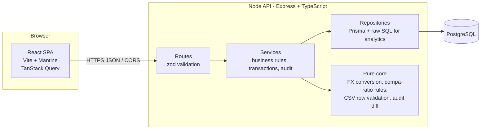

# Design

Companion to [REQUIREMENTS.md](REQUIREMENTS.md). This covers the architecture, data model, API, analytics approach, testing and performance, plus the trade-offs behind each choice.

## Architecture

- **Repo layout:** a TypeScript monorepo using npm workspaces, with `apps/api`, `apps/web` and `packages/shared`. The shared package holds zod schemas, types and constants (e.g. outlier defaults). API validation and frontend forms both use it, so each rule is written once.
- **Layers:**
  - **Routes** only parse and validate input.
  - **Services** hold business rules and wrap each change _and its audit record_ in one DB transaction.
  - **Repositories** are the only code that touches Prisma or SQL.
  - The **pure core** has no I/O and is unit-tested.
- **Deployment:** frontend, API and database are deployed separately. Web on Netlify (`netlify.toml`), API on Render (`render.yaml`), Postgres on Neon, all on free tiers. Vercel was the first choice; sign-up trouble at deploy time made Netlify, an equivalent static host, the pick. The API allows the web origin via CORS, and the web app reads `VITE_API_URL`.

### Key trade-offs

| Choice           | Over                       | Why                                                                                                                                      |
| ---------------- | -------------------------- | ---------------------------------------------------------------------------------------------------------------------------------------- |
| Separate deploys | One server serving the SPA | Each side deploys and scales independently, and the frontend is served from a CDN. The cost is CORS and two URLs.                        |
| Express          | Fastify / NestJS           | Familiar and minimal. Performance differences don't matter at this scale.                                                                |
| Prisma           | Drizzle / raw SQL          | Typed client and migrations. Raw SQL (`$queryRaw`) is used where aggregates need it.                                                     |
| PostgreSQL       | SQLite                     | Native `percentile_cont` and window functions keep analytics in the DB. Free hosts have ephemeral disks, which would wipe a SQLite file. |
| TypeScript       | Plain JS                   | Money arithmetic and shared API shapes benefit from types. Prisma generates them.                                                        |

## Data model

| Table               | Key fields                                                                                                                                                                                                                                                                                            |
| ------------------- | ----------------------------------------------------------------------------------------------------------------------------------------------------------------------------------------------------------------------------------------------------------------------------------------------------- |
| `Employee`          | id, employeeCode (unique, e.g. `E00042`), firstName, lastName, email (unique), countryCode → `Country`, jobTitleId → `JobTitle` (department comes from the title), level (1–6), hireDate, status (`ACTIVE`/`TERMINATED`), terminationDate, **currentBaseSalary, currentTargetBonus, currentCurrency** |
| `CompensationEntry` | id, employeeId, effectiveDate, baseSalary, targetBonus, currency, reason (`HIRE`/`PROMOTION`/`MERIT`/`MARKET_ADJUSTMENT`/`RELOCATION`/`OTHER`); unique (employeeId, effectiveDate), note                                                                                                              |
| `Department`        | id, name (unique)                                                                                                                                                                                                                                                                                     |
| `JobTitle`          | id, name (unique), departmentId → `Department`                                                                                                                                                                                                                                                        |
| `Country`           | code, name, currency                                                                                                                                                                                                                                                                                  |
| `FxRate`            | currency, rateToUsd, asOfDate                                                                                                                                                                                                                                                                         |
| `AuditLog`          | id, actorId → `User`, employeeId, entityType, entityId, action (`CREATE`/`UPDATE`/`TERMINATE`), changes (JSON `[{field, from, to}]`), reason, createdAt                                                                                                                                               |
| `User`              | id, name. Seeded with one "HR Manager"                                                                                                                                                                                                                                                                |

- **Money:** integers in **whole units of local currency**. Annual salaries don't need cents, JPY has no minor unit, and this avoids floating-point drift and Prisma's `Decimal`.
- **Current compensation is stored on `Employee`.** It's recalculated from the latest entry (by effective date) in the same transaction as any entry change. Analytics then read one row per employee with no "latest entry" subquery. The cost is duplicated data, guarded by integration tests that check it matches the history.
- **Reference tables** for departments and job titles keep grouping consistent, and give CSV import and forms something to validate against.
- **Audit:** one row per action, holding a JSON list of field changes. A promotion that changes level, title and pay shows as a single event. The actor comes from `getCurrentUser()`, which returns the seeded HR Manager for now and is the single place real auth would plug in.
- **Currency conversion:** `amount_in_X = amount_local / rateToUsd(local) × rateToUsd(X)`. It's done in SQL for aggregates and in the pure core for single values, and both are tested against the same fixtures.

## API

| Method & path                        | Purpose                                                                                                                                                 |
| ------------------------------------ | ------------------------------------------------------------------------------------------------------------------------------------------------------- |
| `GET /employees`                     | Search, filters (country, dept, title, level, status), sort, pagination                                                                                 |
| `GET /employees/:code`               | Profile, current pay and pay timeline (newest first, % change per entry)                                                                                |
| `GET /employees/:code/audit`         | That employee's change history (who, when, field changes, reason)                                                                                       |
| `POST /employees`                    | Create, with starting pay as the HIRE entry; next code generated                                                                                        |
| `PATCH /employees/:code`             | Edit name, email, title, level, hire date (reason required)                                                                                             |
| `POST /employees/:code/compensation` | New pay entry; a promotion may also change level/title in the same event                                                                                |
| `POST /employees/:code/relocate`     | New country and pay in its currency, as one event                                                                                                       |
| `POST /employees/:code/terminate`    | Soft-terminate (end date + reason)                                                                                                                      |
| `PATCH /compensation/:id`            | Correct a pay entry's amounts or date (reason required; allowed for leavers)                                                                            |
| `GET /audit`                         | Org-wide audit, newest first: `from`, `to` (whole UTC days), `action`, `search` (every word must match name, code or email), paging                     |
| `POST /imports/employees/check`      | CSV as the request body (`?filename=`); every problem by row and column + per-country summary; saves nothing                                            |
| `POST /imports/employees`            | Re-checks, then imports all rows or none: `201 {imported, firstCode, lastCode}` or `422 IMPORT_INVALID` with the report                                 |
| `GET /insights/pay-stats`            | `groupBy` (country/department/jobTitle/level), `metric` (base/total), `currency` (LOCAL or a code), employee filters; per-group stats + a whole-org row |
| `GET /insights/outliers`             | `low`, `high`, `minPeers`, `metric`, `direction`, employee filters, paging; flagged employees + summary                                                 |
| `GET /insights/recent-changes`       | `from`, `to` (default: last 12 months), employee filters; summary, by reason, top 10 raises                                                             |
| `GET /meta`                          | Countries, departments, titles, levels, FX rates + as-of date, outlier defaults                                                                         |

Errors use one JSON shape: `{error: {code, message, details?}}`. Invalid input returns
`400 VALIDATION_ERROR` with one `details` entry per field; malformed JSON returns `400 INVALID_JSON`.

### Employee list (`GET /employees`)

- **Query** (validated with the shared `EmployeeListQuerySchema`, which the web app also uses):
  `page`, `pageSize` (1–100, default 25), `search`, multi-value `country` / `department` /
  `jobTitle` / `level` (`?country=DE&country=GB`), `status` (`ACTIVE` default, `TERMINATED`,
  `ALL`), `sortBy` (`name`, `employeeCode`, `hireDate`, `level`, `baseSalary`, `totalCash`),
  `sortDir`.
- **Search** matches anywhere in full name, email or employee code, case-insensitively.
  LIKE wildcards in the input are escaped, so `100%` matches literally.
- **Pay sorts use the USD equivalent** (amount × FX rate) while amounts are displayed in local
  currency; otherwise ¥8,500,000 (≈ $56k) would rank above $140,000. This needs a computed
  ORDER BY, so the list query is parameterised raw SQL (`Prisma.sql`); sort columns come from a
  fixed allow-list and every value is a bound parameter.
- **Paging:** page numbers with a total count (`total`, `totalPages`), because HR expects
  "page 3 of 378". Offset paging is fine at 10k rows; keyset (cursor) paging is the path if the
  data grows by orders of magnitude. A tie-break on `id` keeps pages stable.
- `GET /meta` returns countries, departments with their titles, levels, FX rates with their
  as-of date and outlier defaults in one call (`Cache-Control: max-age=300`).

### Changing employees: rules and audit

- **One transaction per write:** check the rules → apply the change → re-sync the employee's
  current pay from their latest entry → write one audit row. If anything fails nothing is
  saved (a mutation check that broke the audit write confirmed the employee and pay entry roll
  back).
- **One audit row per action**, with every changed field as `{field, from, to}` and the reason.
  A promotion (pay + level/title) and a relocation (country + currency + pay) are single events.
  Edits that change nothing are rejected rather than audited.
- **Date rules:**
  - _No future dates._ "Today" is the calendar date in **UTC+14**, the furthest-ahead time zone.
    Comparing with the UTC date rejected "today" for users east of UTC every morning (found in a
    browser run at 00:30 local time); this rule never accepts a date that hasn't started
    somewhere and needs no knowledge of the user's time zone.
  - Pay entries fall within employment (not before hire, not after termination).
  - **A new pay change must be dated after the latest entry** (so at most one per day). Without
    this, a backdated change could land before a relocation and take the wrong currency, or
    never become current pay. Earlier entries are fixed with a correction instead.
  - A corrected date stays strictly between its neighbouring entries; the hire entry's date is
    the hire date and moves only when the hire date is edited (which must stay before the
    first pay change).
  - Termination is on or after the latest pay change.
- **Other rules:** promotions change level and/or title and never lower the level; relocation
  needs a different, known country and the server sets the currency; leavers are read-only
  except for pay corrections; emails are unique.
- **Errors:** 404 (unknown employee/entry), 409 (state forbids it: email in use, employee has
  left), 422 (the change breaks a rule), each with a stable `code` and a plain-words `message`.
- **Clock:** the app takes an injectable clock, so tests pin "today" and stay deterministic.

## Analytics

Every insight uses the employee list's own filter SQL (`whereClause`), so a filter includes
exactly the same people everywhere. Leavers are excluded by default.

- **Pay stats:** headcount, min, max, average and total via SQL `GROUP BY`; median via
  `percentile_cont(0.5)`. Only aggregated rows leave the database.
  - **Currency:** with "Local", a breakdown _by country_ keeps each country's own currency
    (exact, no conversion). Anything that mixes countries (other groupings, the whole-org row)
    is converted in SQL as `amount × own rate ÷ target rate`, into USD or the chosen currency.
- **Peer outliers:**
  - Peers share **job title + level + country**, so a group is always one currency and the
    ratio needs no conversion.
  - **Peer compa-ratio = pay ÷ peer-group median**, using base or total cash as selected.
  - Defaults are a band of **0.80–1.20** and a **minimum group of 5**, defined once in
    `packages/shared`. HR can adjust both in the UI, and the API validates `0 < low < 1 < high`.
  - Ordered by distance from 1.00, paged. The summary reports how many groups and employees
    could be judged and how many could not (groups below the minimum are never flagged: with two
    people, one always looks "off").
  - The median is used rather than the mean so one extreme salary doesn't skew the comparison.
    A fixed band is used rather than percentiles because percentiles always flag someone, even
    when pay is fair.
- **Recent changes:** `LAG()` over each employee's **full** history (so the previous entry may
  predate the period), then filtered to the period. Hires (not a raise) and currency changes
  (relocations: no meaningful %) are excluded. Default period: the 12 months ending today
  (UTC+14 rule), computed by a unit-tested helper that handles leap days.

### Validating the outlier detector

The seed deliberately pays ~2% of active employees far from their peers and returns their
codes, which gives the detector a known answer. A test regenerates the 10,000-employee seed,
loads it, and checks the API: **207 of the 209 planted outliers in judgeable groups are found
(99%), with 0 false alarms** among normally paid employees. The two misses were traced: the
planted factor combined with the natural ±10% spread landed them at 0.82 and 1.17, inside the
band, so by the HR rule they are correctly not outliers. The test therefore requires ≥ 95%.

## CSV import

For moving off spreadsheets: one row per **new** employee with their current pay.

- **One definition of the columns** (`IMPORT_COLUMNS` in `packages/shared`: name, example,
  help text) drives the server's header check, the downloadable template and the instructions on
  the Import page, so they can't disagree. Columns may come in any order and any letter case.
- **Check, then import.** Choosing a file runs `check`, which saves nothing and lists every
  problem with its spreadsheet row number and column (first 200, plus the total). `import`
  validates again from scratch, because the file or the data may have changed since.
- **All or nothing**, in one transaction: consecutive employee codes, a HIRE pay entry and a
  CREATE audit entry ("Imported from staff.csv") per employee, exactly as if added in the app;
  then `ANALYZE` (see _Performance_).
- **Same rules as the Add employee form:** rows are validated with the same shared schema, then
  against the data (country and title exist, hire date not in the future, email not already in
  the system or repeated in the file). Data checks run for every well-formed column even when
  other columns in the row are wrong, so a row's problems all show in one pass.
- **New people only:** existing emails are rejected; existing employees are changed from their
  own page, where every change is audited. No bulk overwrite of anyone's pay.
- **Amounts:** `78000` or `78,000`. Any dot is rejected: `78.000` means 78 thousand in much of
  Europe and 78 elsewhere, and guessing could import a salary a thousand times too small.
- **Uploaded text is untrusted.** Rows are parsed as plain arrays and only known column names
  ever become object keys, so a header such as `__proto__` can't reach an object; `csv-parse` is
  pinned to 7.0.3, which fixes a prototype-replacement advisory in its column mapping
  (GHSA-8cw4-87c7-c6xx).
- **Limits:** 10,000 rows and 5 MB (also checked in the browser; the server answers `413` with
  a plain message). Measured on 10,000 rows (856 KB): check 164 ms, import 5.1 s.

## Frontend

React + Vite + Mantine, with TanStack Query for server state and React Router.

| Page                | Contents                                                                                           |
| ------------------- | -------------------------------------------------------------------------------------------------- |
| **Employees**       | Server-paginated table with search and filters                                                     |
| **Employee detail** | Profile, pay timeline, audit history, edit / terminate                                             |
| **Insights**        | Pay explorer, outliers (with band controls), recent changes                                        |
| **Import**          | CSV upload with a row-level error table                                                            |
| **Audit log**       | Every change, newest first, headed by the employee (a link); filters for employee, type and period |

A global **display-currency selector** in the header ("Local currency" or any currency in the FX
table) controls conversion. It is **remembered in the browser** rather than carried in every URL
(a change from the original plan: a query parameter would have to follow every link and tab;
the trade-off is that a shared link opens in the viewer's own currency). Converted figures show
"≈" with the original on hover or underneath. The pay timeline and all forms always stay in the
record's own currency: those are the contract figures, never edited as converted values.

**URL state:** every page builds the next URL from the URL as it is _now_
(`latestSearchParams()`), not from the last render. Two quick changes (setting From then To, a
double click on a sort header) otherwise each started from the same stale parameters and the
second dropped the first. react-router's functional `setSearchParams` passes render-time values
too, so it doesn't avoid this.

### Insights page

- Tabs (Pay explorer · Outliers · Recent changes); tab, settings and filters live in the URL,
  and filters carry over between tabs. The filter modal is the employee list's.
- **Pay explorer:** KPI tiles for the whole organisation; a chart of the median per group; the
  stats table as the table view. Chart choices follow the data-visualisation guidance: ranked
  horizontal bars (largest first; levels keep L1–L6 order), one hue and no legend for a single
  series, names on the axis (long titles never squeezed into short bars), vertical value
  gridlines, hover for range and headcount, and no one-bar chart (a message instead). The chart
  is always in one currency (USD when "Local" is selected); the table may keep each country's
  currency and follows the chart's order rather than ranking mixed currencies by raw numbers.
- **Outliers:** band slider (applied on release), smallest peer group, measure, direction;
  tiles for below/above peers and how many employees were compared; each row shows pay, peer
  median, compa-ratio and an "above/below peers" label (never colour alone).
- **Recent changes:** period, summary tiles, breakdown by reason, largest raises.
- Opening an employee from any of these shows "Back to outliers" (etc.) and returns to the same
  view.

### Employee list page

- **State lives in the URL** (`/employees?country=DE&level=5&sortBy=totalCash&page=2`), parsed
  with the same shared schema as the API. Refresh, back/forward and shared links reproduce
  the view; invalid parameters are dropped instead of breaking the page. Any change other than
  the page number returns to page 1.
- **Toolbar is one fixed row:** a search box (300 ms debounce; spinner while waiting and while
  results load) and a **Filters** button with a badge counting applied values. Filters
  (status, country, department, job title, level) are edited in a modal as a draft and applied
  once with **Apply**; **Reset** and **Cancel** live in the modal. Inline multi-selects were
  tried first and dropped: they grew as values were picked and pushed the page around.
- The table keeps the previous page visible (dimmed) while the next one loads, and has
  loading, empty ("Clear filters") and error ("Try again") states.

### Employee detail and actions

- `/employees/:code`, opened from a list row; **Back** restores the exact filtered list view.
  Shows current pay, profile, the pay timeline (reason tags, % change, "New currency" on
  relocation) and the change history (headline, who/when, reason, field old → new).
- Actions for active employees: **Change pay** (promotion fields appear when chosen, live % vs
  current), **Edit profile**, **Relocate** (shows current pay converted at the static rate as a
  starting point), **Terminate**. **Correct** is on every pay entry, leavers included.
  **Add employee** is on the list and opens the new employee afterwards.
- Forms validate with the same shared schemas as the API before sending. Messages are written
  for HR ("Choose a country", "Must be more than 0") in the shared schemas, so the API returns the
  same wording. API field errors map onto fields; business-rule errors show in the API's words.
- Success notifications appear bottom-right; top-right covered the action buttons for several
  seconds (found because an e2e click waited 5 s for the button to be uncovered).

## Testing

- **Unit (Vitest, no DB, milliseconds):** FX conversion, compa-ratio classification, CSV row validation, audit diff builder, zod schemas.
- **Integration (Vitest + Supertest + Postgres in Docker):** analytics SQL, current-comp sync, audit writes, all-or-nothing import. Each test uses a small hand-made dataset so expected numbers are exact, and the DB is reset between tests.
- **Determinism:** no wall-clock time in logic under test (dates are passed in), and the seed uses a fixed random seed.
- **End-to-end (Playwright, `npm run test:e2e`):** runs its own API (:3100) and web app (:5174)
  against a disposable `salary_e2e` database that is rebuilt and seeded with the deterministic
  dataset before each run, so tests assert exact numbers (e.g. "72 employees match `schmi`").
  Kept out of `npm test` so the fast suite stays fast.
- **Safety:** test and e2e setup refuse any database whose name doesn't end in `_test` /
  `_e2e`, so a misconfigured URL can never truncate dev or production data.
- **Two Playwright projects:** `read-only` (list, insights and currency checks with exact seed
  numbers) runs first; `actions` (an HR journey: add, promote, correct with a rule error,
  terminate) depends on it and has retries off, because a retry would replay steps against data
  the first attempt changed.
- **Ground truth:** the outlier detector is tested against the seed's planted outliers (see
  _Validating the outlier detector_).
- **CI (GitHub Actions, `.github/workflows/ci.yml`):** on every push and pull request, job
  `checks` (lint, format, typecheck, unit + integration tests against a Postgres service) and,
  if it passes, job `e2e` (Playwright, with its own Postgres); the Playwright report and traces
  are uploaded when e2e fails. Both jobs were rehearsed on a fresh clone with no `.env` and only
  the workflow's environment variables before the first push.
- **Current size:** 426 unit + integration tests (shared 71, API 272, web 83) and 18 e2e tests.

## Performance

- Server-side pagination: list endpoints never return all 10k rows.
- Indexes:
  - `Employee(countryCode, jobTitleId, level)`: peer groups and filters
  - `Employee(status)`
  - `Employee(email)` (unique)
  - `CompensationEntry(employeeId, effectiveDate)`
  - `AuditLog(employeeId, createdAt)`
- Aggregation happens in Postgres. Current comp is stored on `Employee`, so stats never scan history.
- The seed inserts in batches (`createMany`) in one transaction: 10k employees and 21.7k entries in 2.8 s.
- Target: list and insight endpoints under 300 ms server-side on 10k employees.
- **Measured** (local, 10k employees): `GET /employees` 3–20 ms across search, multi-filter,
  pay sorts and deep pages; `GET /meta` 4 ms; pay stats 4–14 ms; outliers 6–32 ms; recent
  changes 26–80 ms (window function over 21.7k pay entries).
- **Statistics after bulk loads:** right after inserting 10k rows into freshly emptied tables,
  Postgres still assumed they were nearly empty and the outlier query took **14 s instead of
  40 ms** until autovacuum caught up. The seed now runs `ANALYZE` on the loaded tables, with a
  test that checks the row estimates (and fails without it). CSV import must do the same.

## Seed data

- **Deterministic:** a pure generator with a fixed seed (42) and reference date (2026-11-01),
  so every machine gets the identical dataset. The wall clock is never used.
- **Pay model:** country base × title factor × level factor × ±10% spread; target bonus %
  rises with level (doubled for sales). Tables live in `apps/api/prisma/seed/pay-model.ts`.
- **Workforce mix:** weighted countries and departments, a level pyramid, managers only at
  L4–L6 and SDRs only at L1–L3.
- **History:** built backwards from current pay: the hire entry plus 0–4 merit, promotion or
  market changes, so the latest entry always equals current pay.
- **Leavers and outliers:** ~6% terminated; ~2% of active employees deliberately paid far
  from their peers (compa-ratio 0.60–0.75 or 1.30–1.50), so outlier detection has
  something real to find.
- **No audit rows:** seeded records represent data migrated before go-live.
- **Measured** (local Docker Postgres): 10,000 employees and 21,697 compensation entries;
  generation ~20 ms; full seed 2.8 s; reset + seed 3.8 s.

## Deployment

| Part     | Where               | Config         | Notes                                                                     |
| -------- | ------------------- | -------------- | ------------------------------------------------------------------------- |
| Web      | Netlify (static)    | `netlify.toml` | Built from the repo root; every path serves `index.html` (deep links)     |
| API      | Render (Node, free) | `render.yaml`  | Migrations run at start; health check `/health`; sleeps after 15 min idle |
| Database | Neon Postgres 17    | n/a            | Same region as the API (US West, Oregon); direct (unpooled) connection    |

- **Live:** https://salary-management-app.netlify.app, API https://salary-api-qbhq.onrender.com.
- **Secrets** (`DATABASE_URL`, `CORS_ORIGIN`) live only in the Render dashboard; `VITE_API_URL` is
  public by nature (it is compiled into the web bundle).
- **Seeding** is a one-time step run from a developer machine against the hosted database, so
  its connection string never goes into the repository or CI. Seed transactions allow 30 s to
  start and 120 s to finish: a serverless database may be waking up, and each statement pays
  the network round trip.
- **Cold starts:** after 15 idle minutes the first request takes up to a minute; the header
  badge says "API waking up…" (with an explanation) after 3 s and the health check retries.
- **Checked before going live:** the compiled API against a real database, the production web
  build with deep links, and the hosting build commands on a clean copy. Then the live site was
  driven in a browser, including one write (a pay change noted as a deployment check, kept in
  the audit log).

## Known issues

| Issue                                                                                                                                                                                                                                                                          | Risk                                                                                                                   | Plan                                                                                                                                                                            |
| ------------------------------------------------------------------------------------------------------------------------------------------------------------------------------------------------------------------------------------------------------------------------------ | ---------------------------------------------------------------------------------------------------------------------- | ------------------------------------------------------------------------------------------------------------------------------------------------------------------------------- |
| `npm audit`: high-severity ReDoS in `effect` ≤ 3.22.0 ([GHSA-7589-6fvf-x4pw](https://github.com/advisories/GHSA-7589-6fvf-x4pw)), pulled in by the Prisma CLI (`prisma` → `@prisma/config` → `effect@3.20.0`, pinned exactly).                                                 | Negligible. Dev-time CLI only: it parses our own config file, never user input, and is not part of the runtime client. | Remove when Prisma updates its pin. `npm audit fix --force` would downgrade Prisma to v6, and an npm `overrides` entry did not apply cleanly against the pin (see AI_USAGE.md). |
| Web production bundle is 624 kB (190 kB gzipped), above Vite's 500 kB warning; most of it is Mantine.                                                                                                                                                                          | Low for an internal tool on office networks.                                                                           | Split routes into lazily loaded chunks in the wrap-up step if time allows.                                                                                                      |
| CI actions are pinned to major-version tags (`actions/checkout@v7`), which a compromised tag could change.                                                                                                                                                                     | Low for this project.                                                                                                  | Pin each action to a full commit SHA (with a tool such as Dependabot to keep them current) if this becomes a production pipeline.                                               |
| `pg` prints "Calling client.query() when the client is already executing a query is deprecated" during some transactions. Reproduced with a single `findFirst({ include })` inside `$transaction`: Prisma's adapter runs the include's queries concurrently on one connection. | None today: `pg` 8 queues the queries. It becomes an error in `pg` 9.                                                  | Not our code; keep `pg` on 8 until Prisma's adapter handles it, then upgrade both together.                                                                                     |
